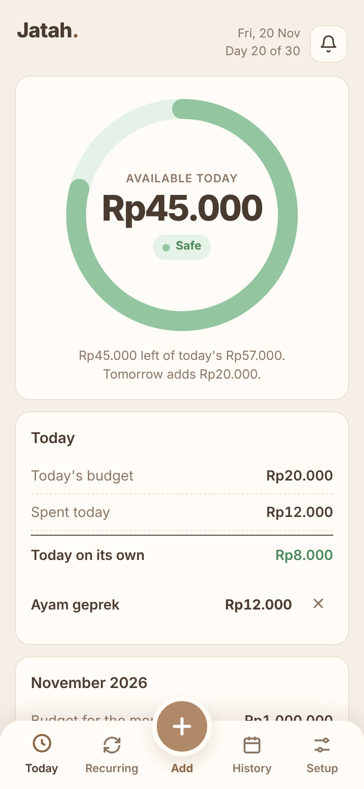
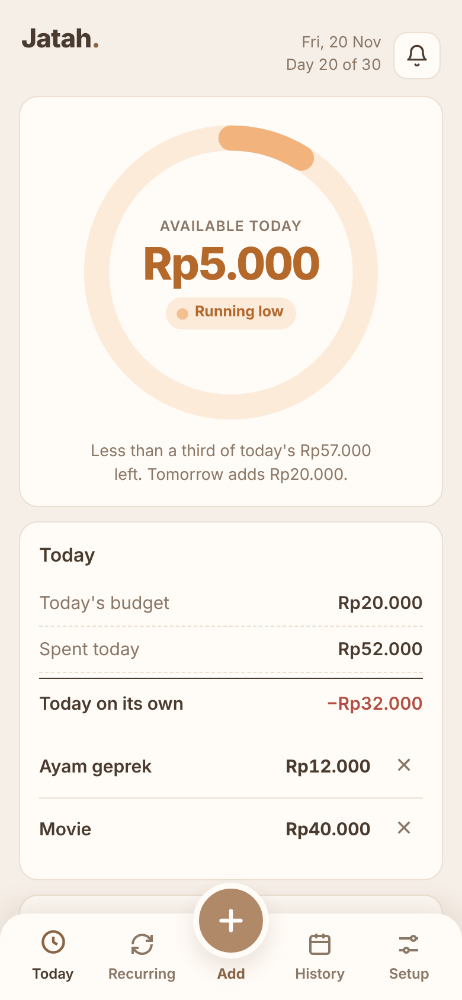
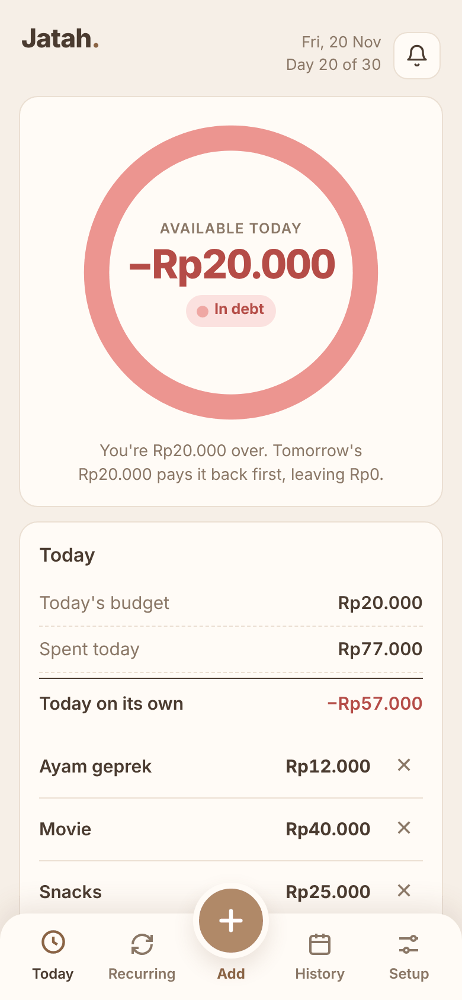
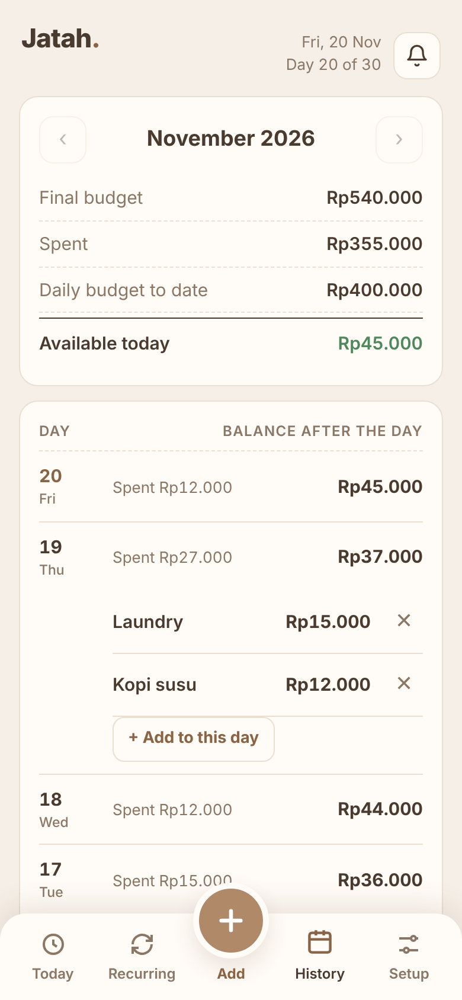
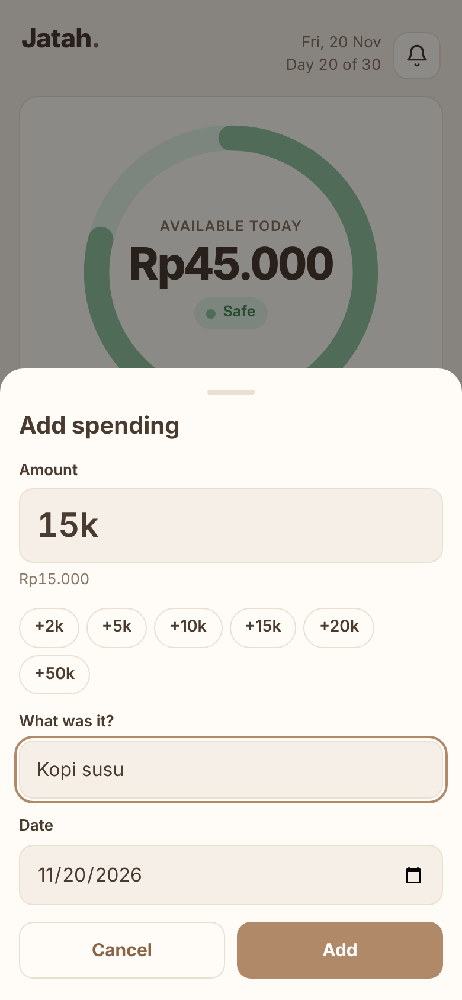
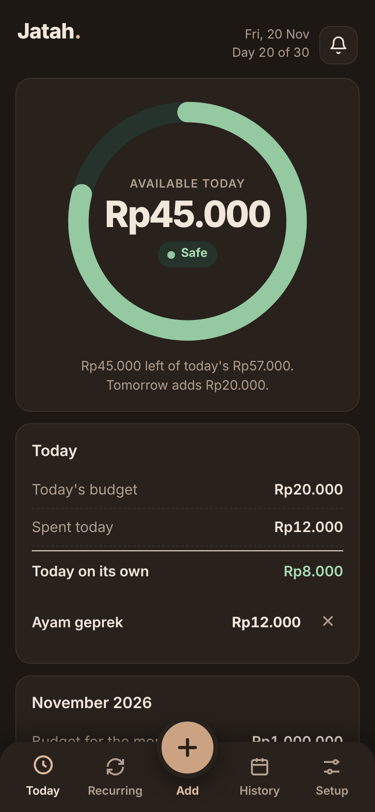

# Jatah.

A budget tracker with just what you need, nothing more, nothing less. No accounts, no bank links, and your data never leaves your phone.

  
  
  

  
  
  

## How it works

You give yourself an allowance every day, and whatever you don't spend carries over.

- **Budget**: what you live on, per month, per semester or per year. Rp6.000.000 every 6 months becomes Rp1.000.000 a month.
- **Recurring payments**: subscriptions and bills. Monthly ones come out on the 1st. Longer ones are spread out by default, so a Rp180.000 yearly fee sets aside Rp15.000 every month (or take it all at once in the month it's due, if you prefer).
- **Daily budget**: what you get each day, say Rp20.000. Skip spending for 3 days and you have Rp60.000.
- **Available today**: everything you've been given so far this month, minus everything you've spent.
- **Overspend?** You go negative, and tomorrow's allowance pays it back first.
- **Starting mid-month?** Tell it how much you have left, and it plans the rest of the month around that. Your normal budget starts on the 1st.

The app also suggests a daily budget (what's left after recurring payments ÷ days in the month, rounded down to the thousand), and the 🔔 bell lets you know when payments come out, when something's due next month, when your daily budget won't fit, and when it's time for a backup.

The ring on the Today screen shows today's money (what you carried over plus today's allowance). It starts each day full and empties as you spend:

| | |
| --- | --- |
| 🟢 **Safe** | More than a third of today's money is left. |
| 🟠 **Running low** | Less than a third of today's money left (or less than a third of a day's budget). |
| 🔴 **In debt** | You're below zero. The ring shows how much of tomorrow you've already used. |

## Get it

**Android**: download `jatah.apk` from the [latest release](https://github.com/d4nzk/jatah/releases/latest) on your phone and open it. Android will ask you to allow installing apps from your browser the first time. New versions install over the old one and keep your data.

**iPhone, or any phone**: open **[d4nzk.github.io/jatah](https://d4nzk.github.io/jatah/)**.
- iPhone: in Safari, tap *Share* → *Add to Home Screen*.
- Android: in Chrome, tap *⋮* → *Install app*.

It gets its own icon, opens full screen and works offline.

## Your data

- Everything is stored on your phone only. There's no server, no account, no analytics, and nothing is sent anywhere.
- Because of that, nobody can recover your data for you. Use **Setup → Copy backup** now and then and keep the text somewhere safe. **Restore backup** brings it back on any phone.
- The Android app and the web version keep separate data. Use backup and restore to move between them.

## Built with

Plain HTML, CSS and JavaScript in a single file (`www/index.html`), with no framework and no build step. [Capacitor](https://capacitorjs.com/) wraps it into the Android app, and GitHub Actions builds the APK and publishes the web version.

## Running it yourself

Open `www/index.html` in a browser, and that's it.

If you fork this and want your own APK, you'll need your own signing key. See [docs/RELEASING.md](docs/RELEASING.md).

## AI Usage Transparency

This project was fully built by Claude with my own prompts. I didn't build any of the code, but i take all of the responsibility for the app and bugs inside the app.